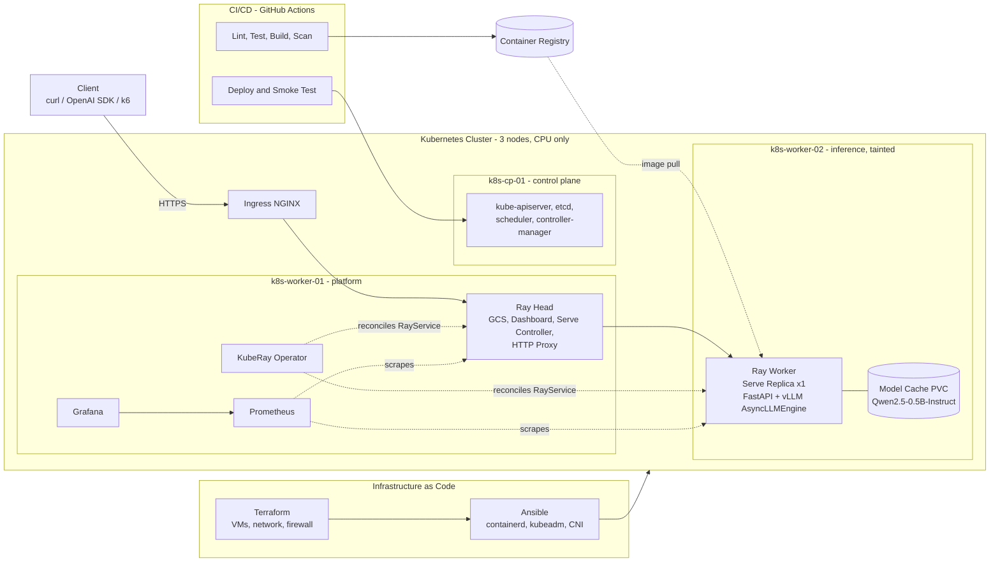
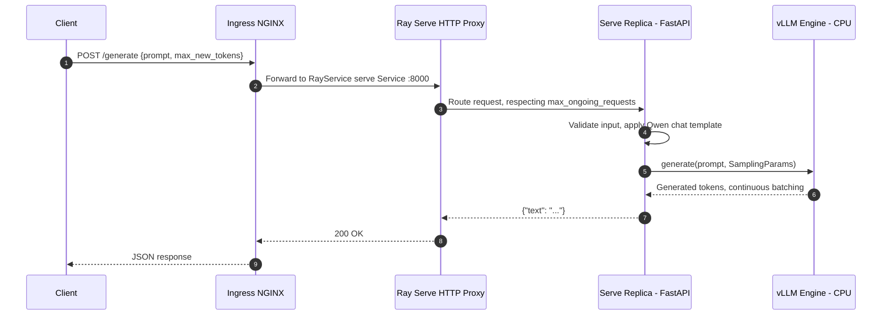
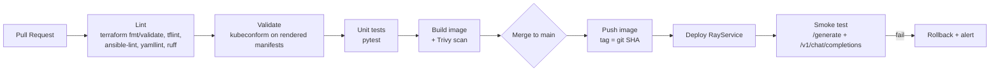

# qwen-k8s-serve — AIOps Text Generation Cloud Service

> A production-like, fully automated Text Generation API serving **Qwen2.5-0.5B-Instruct** on a
> CPU-only, 3-node Kubernetes cluster with **KubeRay**, **Ray Serve**, and **vLLM** — provisioned
> with Infrastructure as Code, shipped through CI/CD, and observed end-to-end with Prometheus and Grafana.

[](LICENSE)


> **Status:** 🚧 Work in progress — progress is tracked in [ROADMAP.md](ROADMAP.md).

---

## Table of Contents

- [Overview](#overview)
- [Architecture](#architecture)
- [Technology Stack](#technology-stack)
- [Repository Structure](#repository-structure)
- [Prerequisites](#prerequisites)
- [Quick Start / Deployment Guide](#quick-start--deployment-guide)
- [API Usage](#api-usage)
- [CI/CD](#cicd)
- [Monitoring & Observability](#monitoring--observability)
- [Load Testing & Benchmarking](#load-testing--benchmarking)
- [Security Considerations](#security-considerations)
- [Teardown](#teardown)
- [AI Usage Disclosure](#ai-usage-disclosure)
- [Author](#author)
- [License](#license)

---

## Overview

This repository is my submission for the **ArvanCloud Site Reliability Engineering technical challenge**.
The objective is to design, provision, and operate a scalable text generation service the way it would
be run in production: reproducible infrastructure, declarative deployments, automated delivery,
measurable reliability, and data-driven performance tuning.

**Key capabilities**

| Capability | Implementation |
|------------|----------------|
| Infrastructure | 3 VMs provisioned by Terraform, configured into a Kubernetes cluster by Ansible |
| Model serving | `Qwen/Qwen2.5-0.5B-Instruct` on vLLM (CPU backend), orchestrated by Ray Serve on KubeRay, 1 replica |
| Custom API | `POST /generate` — `prompt` + `max_new_tokens` (≤ 64) → `{"text": "..."}` |
| OpenAI compatibility | `/v1/models`, `/v1/chat/completions`, `/v1/completions` (incl. streaming) |
| Delivery | GitHub Actions: lint → test → build → scan → deploy → smoke test |
| Observability | kube-prometheus-stack, Ray & vLLM metrics, provisioned Grafana dashboards, alerting |
| Reliability | k6 load tests with randomized prompts, resource tuning, before/after benchmarks |

---

## Architecture

### High-level view



### Request flow



### Design decisions

- **Node roles.** The control plane is kept free of workloads. Platform services (Ray head, KubeRay operator, monitoring) run on `k8s-worker-01`; `k8s-worker-02` is tainted `workload=inference:NoSchedule` so the vLLM replica has dedicated, uncontended CPU.
- **Ray head does no inference.** The head is started with `num-cpus: 0`, so Ray only schedules Serve replicas on the worker group.
- **Single-replica serving.** The challenge mandates 1 replica; throughput is gained through vLLM continuous batching and CPU tuning rather than horizontal scaling. The `RayService` is ready for Serve autoscaling if the constraint is lifted.
- **Model pre-staging.** Weights are downloaded once into a PVC, removing Hugging Face from the critical path of pod restarts.
- **Back-pressure over queueing.** Ray Serve `max_ongoing_requests` / `max_queued_requests` bound in-flight work and return `503` under overload instead of letting latency grow without limit.

---

## Technology Stack

| Layer | Technology | Purpose |
|-------|------------|---------|
| Infrastructure as Code | **Terraform** | Provision VMs, private network, security groups, SSH keys; generate Ansible inventory |
| Configuration management | **Ansible** | OS hardening, containerd, kubeadm cluster bootstrap, add-ons |
| Container orchestration | **Kubernetes** (kubeadm) | 3-node cluster: 1 control plane, 2 workers |
| Networking | **Calico** / **Cilium**, **ingress-nginx** | Pod networking, network policies, north-south traffic |
| Storage | **local-path-provisioner** | PVCs for model cache and Prometheus TSDB |
| Distributed compute | **KubeRay** | Operator managing the `RayService` lifecycle (incl. zero-downtime upgrades) |
| Model serving | **Ray Serve** | HTTP proxy, routing, replica management, back-pressure |
| Inference engine | **vLLM** (CPU backend) | Continuous batching, PagedAttention KV-cache, OpenAI-compatible protocol |
| Model | **Qwen/Qwen2.5-0.5B-Instruct** | 0.5B-parameter instruction-tuned LLM |
| API framework | **FastAPI** + Pydantic | `/generate` and OpenAI-compatible endpoints with schema validation |
| Monitoring | **Prometheus** (kube-prometheus-stack) | Metrics collection, recording and alerting rules |
| Visualization | **Grafana** | Dashboards provisioned as code |
| CI/CD | **GitHub Actions** | Lint, test, build, scan, deploy, smoke test |
| Security scanning | **Trivy**, **gitleaks** | Image vulnerability and secret scanning |
| Load testing | **k6** | Randomized-prompt load, stress, and soak scenarios |

---

## Repository Structure

```
.
├── terraform/              # VM, network, firewall, SSH key provisioning
│   ├── modules/node/
│   └── environments/prod/
├── ansible/                # Node preparation and kubeadm cluster bootstrap
│   ├── inventory/          # Generated by Terraform
│   ├── roles/
│   └── site.yml
├── docker/                 # Ray + vLLM CPU runtime image
├── serve/                  # Ray Serve application (FastAPI ingress + vLLM engine)
│   ├── app/
│   └── tests/
├── k8s/                    # Kubernetes manifests and Helm values
│   ├── base/
│   ├── kuberay/
│   ├── rayservice/
│   └── ingress/
├── monitoring/             # ServiceMonitors, PodMonitors, alert rules, Grafana dashboards
├── loadtest/               # k6 scenarios and random prompt corpus
├── benchmarks/             # Raw results and before/after report
├── docs/                   # Architecture, runbook, access guide
├── .github/workflows/      # CI/CD pipelines
├── Makefile                # Single entry point for all operations
├── ROADMAP.md
├── ai-usage.md
└── README.md
```

---

## Prerequisites

### Accounts & access

- A cloud account with API credentials (ArvanCloud IaaS or any Terraform-supported provider)
- A container registry (GHCR or ArvanCloud Container Registry)
- An SSH key pair for node access
- *(Optional)* A DNS record pointing to the ingress public IP for TLS

### Recommended node sizing

| Node | Role | vCPU | RAM | Disk |
|------|------|------|-----|------|
| `k8s-cp-01` | Control plane | 4 | 8 GiB | 50 GiB |
| `k8s-worker-01` | Ray head, operator, monitoring, ingress | 8 | 16 GiB | 80 GiB |
| `k8s-worker-02` | Ray worker — vLLM inference | 8 | 16 GiB | 80 GiB |

> vLLM's CPU backend benefits significantly from **AVX-512** (and AMX/BF16 where available).
> Verify with `lscpu | grep -E 'avx512|avx2|amx'`.

### Local tooling

| Tool | Minimum version |
|------|-----------------|
| Terraform | 1.6 |
| Ansible | 2.15 (ansible-core) |
| kubectl | 1.30 |
| Helm | 3.14 |
| Docker / Podman | 24 / 4.9 |
| k6 | 0.50 |
| Python | 3.11 |
| GNU Make | 4.x |

---

## Quick Start / Deployment Guide

Every step below is automated; `make all` runs the full sequence. The individual steps are listed for
transparency and troubleshooting.

### 1. Clone and configure

```bash
git clone git@github.com:sunba91-su/qwen-k8s-serve.git
cd qwen-k8s-serve

cp .env.example .env              # cloud credentials, registry, domain - never committed
set -a && source .env && set +a
```

### 2. Provision infrastructure (Terraform)

```bash
cd terraform/environments/prod
terraform init
terraform plan -out=tfplan
terraform apply tfplan
cd -
```

Terraform outputs the node IPs and writes the Ansible inventory to `ansible/inventory/hosts.ini`.

### 3. Bootstrap Kubernetes (Ansible)

```bash
cd ansible
ansible all -m ping
ansible-playbook site.yml
cd -

export KUBECONFIG=$PWD/kubeconfig   # fetched from the control plane by the playbook
kubectl get nodes -o wide
```

Expected result: three nodes in `Ready` state.

### 4. Install cluster add-ons and monitoring

```bash
make addons        # CNI, ingress-nginx, local-path-provisioner, metrics-server
make monitoring    # kube-prometheus-stack + Ray/vLLM monitors + Grafana dashboards
```

### 5. Build and push the serving image

```bash
export IMAGE=ghcr.io/sunba91-su/qwen-k8s-serve:$(git rev-parse --short HEAD)
docker build -t "$IMAGE" -f docker/Dockerfile .
docker push "$IMAGE"
```

> In normal operation this step is performed by the CD pipeline.

### 6. Deploy KubeRay and the model

```bash
helm repo add kuberay https://ray-project.github.io/kuberay-helm/
helm upgrade --install kuberay-operator kuberay/kuberay-operator \
  --namespace ray-system --create-namespace \
  -f k8s/kuberay/values.yaml

kubectl apply -k k8s/rayservice/

kubectl -n llm get rayservice qwen-serve -w
```

Wait until the `RayService` reports `Running` and the Serve application is `HEALTHY`. The first start
takes several minutes while the model is staged into the PVC and loaded by vLLM.

### 7. Verify

```bash
export API_URL=https://api.example.com   # or http://<ingress-ip>
curl -s "$API_URL/healthz"
curl -s "$API_URL/v1/models" | jq
```

---

## API Usage

| Method | Path | Description |
|--------|------|-------------|
| `POST` | `/generate` | Simple text generation |
| `GET` | `/v1/models` | List served models (OpenAI-compatible) |
| `POST` | `/v1/chat/completions` | Chat completions (OpenAI-compatible, supports `stream`) |
| `POST` | `/v1/completions` | Text completions (OpenAI-compatible) |
| `GET` | `/healthz` | Liveness |
| `GET` | `/readyz` | Readiness (model loaded) |

### `POST /generate`

**Request body**

| Field | Type | Required | Constraints |
|-------|------|----------|-------------|
| `prompt` | string | yes | Non-empty |
| `max_new_tokens` | integer | no | `1`–`64`, default `64` |

```bash
curl -s -X POST "$API_URL/generate" \
  -H "Content-Type: application/json" \
  -d '{
        "prompt": "Explain what a Kubernetes operator is in one sentence.",
        "max_new_tokens": 64
      }' | jq
```

**Response — `200 OK`**

```json
{
  "text": "A Kubernetes operator is a controller that extends the Kubernetes API to automate the lifecycle management of complex, stateful applications."
}
```

**Validation error — `422 Unprocessable Entity`** (e.g. `max_new_tokens: 128`)

```json
{
  "detail": [
    {
      "type": "less_than_equal",
      "loc": ["body", "max_new_tokens"],
      "msg": "Input should be less than or equal to 64",
      "input": 128
    }
  ]
}
```

### OpenAI-compatible: Chat Completions

```bash
curl -s "$API_URL/v1/chat/completions" \
  -H "Content-Type: application/json" \
  -d '{
        "model": "Qwen/Qwen2.5-0.5B-Instruct",
        "messages": [
          {"role": "system", "content": "You are a concise SRE assistant."},
          {"role": "user", "content": "What is an error budget?"}
        ],
        "max_tokens": 64,
        "temperature": 0.7
      }' | jq
```

**Streaming (Server-Sent Events)**

```bash
curl -N "$API_URL/v1/chat/completions" \
  -H "Content-Type: application/json" \
  -d '{
        "model": "Qwen/Qwen2.5-0.5B-Instruct",
        "messages": [{"role": "user", "content": "List three SLIs for an LLM API."}],
        "max_tokens": 64,
        "stream": true
      }'
```

### OpenAI-compatible: Completions

```bash
curl -s "$API_URL/v1/completions" \
  -H "Content-Type: application/json" \
  -d '{
        "model": "Qwen/Qwen2.5-0.5B-Instruct",
        "prompt": "The three pillars of observability are",
        "max_tokens": 32
      }' | jq
```

### OpenAI Python SDK

```python
from openai import OpenAI

client = OpenAI(base_url="https://api.example.com/v1", api_key="not-needed")

response = client.chat.completions.create(
    model="Qwen/Qwen2.5-0.5B-Instruct",
    messages=[{"role": "user", "content": "Give me one tip for reducing MTTR."}],
    max_tokens=64,
)
print(response.choices[0].message.content)
```

---

## CI/CD

Pipelines live in [`.github/workflows/`](.github/workflows/).



| Workflow | Trigger | Responsibility |
|----------|---------|----------------|
| `ci.yml` | Pull request | Static analysis, manifest validation, unit tests, image build and scan |
| `cd.yml` | Push to `main` | Push image, deploy `RayService`, smoke test, rollback on failure |
| `infra.yml` | Changes under `terraform/` | `terraform plan` on PR; manually approved `apply` |

Cluster credentials are stored as encrypted repository secrets and bound to a least-privilege
ServiceAccount scoped to the application namespace.

---

## Monitoring & Observability

The monitoring stack is based on **kube-prometheus-stack**. Ray and vLLM metrics are scraped via
`PodMonitor` / `ServiceMonitor` resources, and all Grafana dashboards are provisioned from
[`monitoring/dashboards/`](monitoring/dashboards/).

```bash
kubectl -n monitoring port-forward svc/kube-prometheus-stack-grafana 3000:80
# open http://localhost:3000
```

### Dashboards

| Dashboard | Key signals |
|-----------|-------------|
| **Cluster Overview** | Node CPU / memory / disk / network, pod restarts, requests vs. actual usage |
| **Ray Cluster & Serve** | Ray resources, Serve replica health, request rate, Serve latency, error rate |
| **LLM Inference (vLLM)** | Generation tokens/s, TTFT p50/p95/p99, time per output token, running vs. waiting requests, KV-cache utilization |
| **API SLO** | Availability, 5xx ratio, latency vs. objective, error-budget burn rate |

### Alerting (examples)

| Alert | Condition |
|-------|-----------|
| `RayServeReplicaUnhealthy` | Serve replica not healthy for > 2 min |
| `LLMHighErrorRate` | 5xx ratio > 5% over 5 min |
| `LLMLatencySLOBreach` | p95 `/generate` latency above objective for 10 min |
| `NodeMemoryPressure` | Node available memory < 10% |
| `PodOOMKilled` | Any container terminated with `OOMKilled` |

---

## Load Testing & Benchmarking

Load tests use **k6** with a corpus of randomized prompts ([`loadtest/prompts.json`](loadtest/prompts.json))
and a random `max_new_tokens` in the range 1–64 per request.

```bash
k6 run -e API_URL="$API_URL" loadtest/smoke.js     # sanity check, 1 VU
k6 run -e API_URL="$API_URL" loadtest/load.js      # ramp to target concurrency, sustained
k6 run -e API_URL="$API_URL" loadtest/stress.js    # find the saturation point
```

### Methodology

1. **Baseline:** run the suite against the default, untuned deployment; store results in `benchmarks/before/`.
2. **Optimize:** change one variable at a time and record each experiment in `benchmarks/experiments.md`:
   - right-sized CPU/memory requests and limits, Guaranteed QoS with static CPU manager pinning
   - vLLM CPU tuning: `VLLM_CPU_KVCACHE_SPACE`, `VLLM_CPU_OMP_THREADS_BIND`, `max_num_seqs`, `max_num_batched_tokens`, `max_model_len`
   - Ray Serve concurrency: `max_ongoing_requests`, timeouts; Ray head `num-cpus: 0`
   - workload isolation through taints, tolerations, and node affinity
3. **After:** re-run the identical suite; store results in `benchmarks/after/`.
4. **Report:** analysis and Grafana snapshots in [`benchmarks/REPORT.md`](benchmarks/REPORT.md).

### Results summary

| Metric | Before | After | Change |
|--------|--------|-------|--------|
| Sustained throughput (req/s) | _TBD_ | _TBD_ | _TBD_ |
| Output tokens/s | _TBD_ | _TBD_ | _TBD_ |
| p50 latency `/generate` | _TBD_ | _TBD_ | _TBD_ |
| p95 latency `/generate` | _TBD_ | _TBD_ | _TBD_ |
| p95 TTFT | _TBD_ | _TBD_ | _TBD_ |
| Error rate | _TBD_ | _TBD_ | _TBD_ |
| Inference pod CPU utilization | _TBD_ | _TBD_ | _TBD_ |
| Inference pod memory (peak) | _TBD_ | _TBD_ | _TBD_ |

---

## Security Considerations

- No secrets in Git: credentials are provided via environment variables and CI secrets; `gitleaks` runs in CI.
- Kubeconfig and SSH keys for reviewers are shared **out-of-band** (see [`docs/access.md`](docs/access.md)), using a dedicated read-only ServiceAccount and a time-limited SSH key.
- SSH password authentication is disabled; firewall rules restrict the API server and NodePort ranges.
- Container images run as non-root and are scanned with Trivy before deployment.
- NetworkPolicies restrict traffic to the inference namespace to the ingress controller and Prometheus.

---

## Teardown

```bash
make destroy
# equivalent to:
# cd terraform/environments/prod && terraform destroy
```

---

## AI Usage Disclosure

AI-assisted tooling was used during this project. Details on which tools were used, for which tasks,
and how their output was reviewed and validated are documented in [`ai-usage.md`](ai-usage.md).

---

## Author

**Mohammad Sajjad Asiyabani**
Site Reliability Engineer

- GitHub: [@sunba91-su](https://github.com/sunba91-su)

Prepared as part of the **ArvanCloud SRE Technical Challenge**.

---

## License

Distributed under the Apache License 2.0. See [LICENSE](LICENSE) for details.
